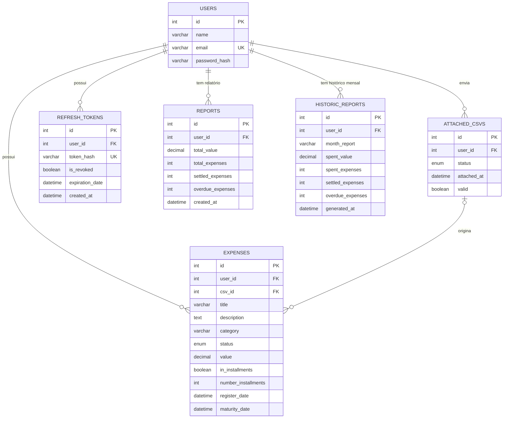

# Sistema de Gerenciamento de Gastos

API REST para gerenciamento de gastos mensais (aluguel, água, luz, parcelas etc.), construída com Flask e SQL puro. Permite cadastrar despesas manualmente ou enviar um CSV que é processado em segundo plano, acompanhar dívidas pendentes e consultar relatórios mensais.

Conta com autenticação via JWT (access token + refresh token com rotação), tarefas em segundo plano com Celery e RabbitMQ, banco MySQL e documentação interativa da API com Swagger. Todo o ambiente de desenvolvimento roda em Docker.

## Requisitos

- Docker e Docker Compose
- Python 3.12+ (apenas para rodar testes, linters e MkDocs fora do container)

## Instalação

```bash
# Clone o repositório
git clone https://github.com/Eric-Cardoso/expense-manager-api.git
cd expense-manager-api

# Crie e ative um ambiente virtual
python3 -m venv venv
source venv/bin/activate
# Windows: python -m venv venv && venv\Scripts\activate

# Instale as dependências
pip install -r requirements.txt
```

## Configuração

Copie o arquivo de exemplo e preencha as variáveis:

```bash
cp .env.example .env
```

```dotenv
# DOCKER / CONTAINERS
MYSQL_IMAGE=
RABBITMQ_IMAGE=
CONTAINER_DATABASE_NAME=
CONTAINER_API_NAME=
CONTAINER_RABBITMQ_NAME=
CONTAINER_CELERY_NAME=

# DATABASE (MySQL)
MYSQL_DATABASE=
MYSQL_USER=
MYSQL_PASSWORD=
MYSQL_ROOT_PASSWORD=
RABBITMQ_DEFAULT_USER=
RABBITMQ_DEFAULT_PASS=
DATABASE_HOST=
DATABASE_PORT=
RABBITMQ_PORT_INTERFACE=
RABBITMQ_PORT_AMQP=

# API
API_PORT=

# TOKEN
SECRET_KEY=
ALGORITHM=
ACCESS_TOKEN_EXPIRATION_TIME=
REFRESH_TOKEN_EXPIRATION_TIME=
```

> ⚠️ Nunca versione o `.env`. Use uma `SECRET_KEY` longa e aleatória.

## Subindo o ambiente

```bash
docker compose up --build
```

A API fica disponível em `http://localhost:<API_PORT>`, usando a porta definida no `.env`.

## Configurando o banco de dados

Não há nada para rodar manualmente: na **primeira** subida do container do MySQL, os arquivos `.sql` da pasta `migrations/` são executados automaticamente e criam as tabelas. Os dados persistem entre reinicializações no volume `mysql_data`.

Para recriar o banco do zero (apaga todos os dados):

```bash
docker compose down -v
docker compose up --build
```

## Uso

Com o ambiente no ar, acesse a documentação interativa em `http://localhost:<API_PORT>/docs/swagger`.

Fluxo básico:

1. Crie um usuário em `POST /users/`.
2. Faça login em `POST /auth/login/` e copie o `access_token`.
3. Use o token no header `Authorization: Bearer <access_token>` para acessar as demais rotas (despesas, CSVs e relatórios).

## Modelo de dados



## Rodando os testes

```bash
pytest
```

## Rodando os linters

O projeto segue a ordem `isort` → `black` → `flake8`:

```bash
isort .
black .
flake8
```

## Quer saber mais?

Este README cobre o básico para você rodar o projeto rapidamente. Para detalhes de arquitetura, regras de negócio, autenticação, processamento de CSV e decisões técnicas, consulte a **documentação completa** gerada com MkDocs.

Para visualizar a documentação localmente (o MkDocs roda fora do Docker):

```bash
mkdocs serve
```

Depois é só acessar `http://127.0.0.1:8000` no navegador. A documentação atualiza automaticamente conforme os arquivos são editados.

Se quiser gerar a versão estática (por exemplo, para hospedar em algum lugar):

```bash
mkdocs build
```

Isso vai gerar o site pronto na pasta `site/`.