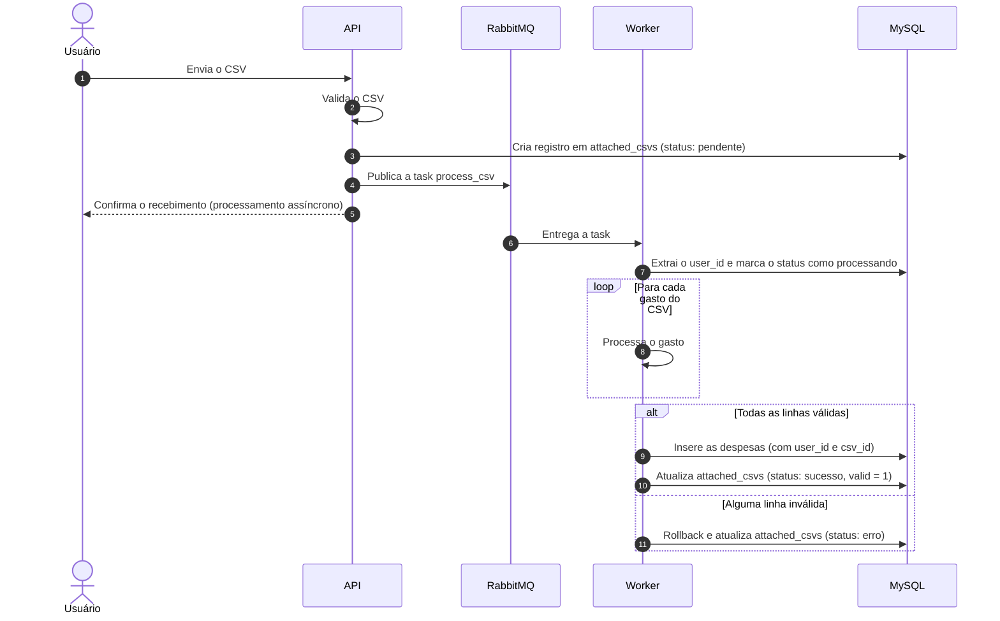
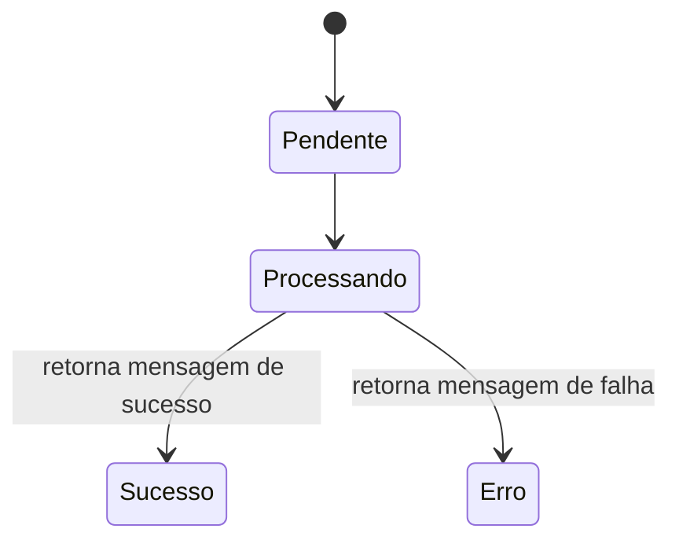

# Processamento de CSV

O envio de CSV é o único fluxo **assíncrono** da API. A requisição do usuário termina rápido, e o trabalho pesado acontece em um worker do Celery.

## Sequência

## Estados do CSV

| Estado | Significado |
|--------|-------------|
| `pendente` | CSV recebido e task publicada, aguardando o worker |
| `processando` | Worker começou a ler o arquivo |
| `sucesso` | Todas as despesas foram gravadas |
| `erro` | Alguma linha era inválida ou a task falhou: nada foi gravado |

## Regras do processamento

- **Tudo ou nada**: o CSV é processado como uma unidade. Se qualquer linha for inválida, ocorre *rollback* e nenhuma despesa daquele CSV é gravada.
- **Status `processando` é gravado antes do loop**: assim o usuário vê que o worker já pegou o job.
- **`valid` só vira `true` no sucesso**: o registro nasce com `valid = false`.
- **Sem notificação**: o usuário descobre o resultado consultando `GET /csvs/<id>`.

## Configuração do worker

| Configuração | Valor |
|--------------|-------|
| Broker | RabbitMQ |
| `worker_concurrency` | `1` |
| `worker_prefetch_multiplier` | `2` |
| `acks_late` | habilitado |
| Time limits | 300 s e 150 s |

A task `process_csv` fica em `tasks/csv_tasks.py` e é registrada com `@celery_app.task`, vinculada à instância criada em `app/celery.py`.

!!! tip "Por que `@celery_app.task`?"
    Com `@shared_task`, a task não ficava amarrada ao `celery_app` configurado e o `.delay()` falhava com *Connection refused* ao publicar no RabbitMQ. Usar `@celery_app.task` resolve, porque a task passa a usar o broker configurado.
