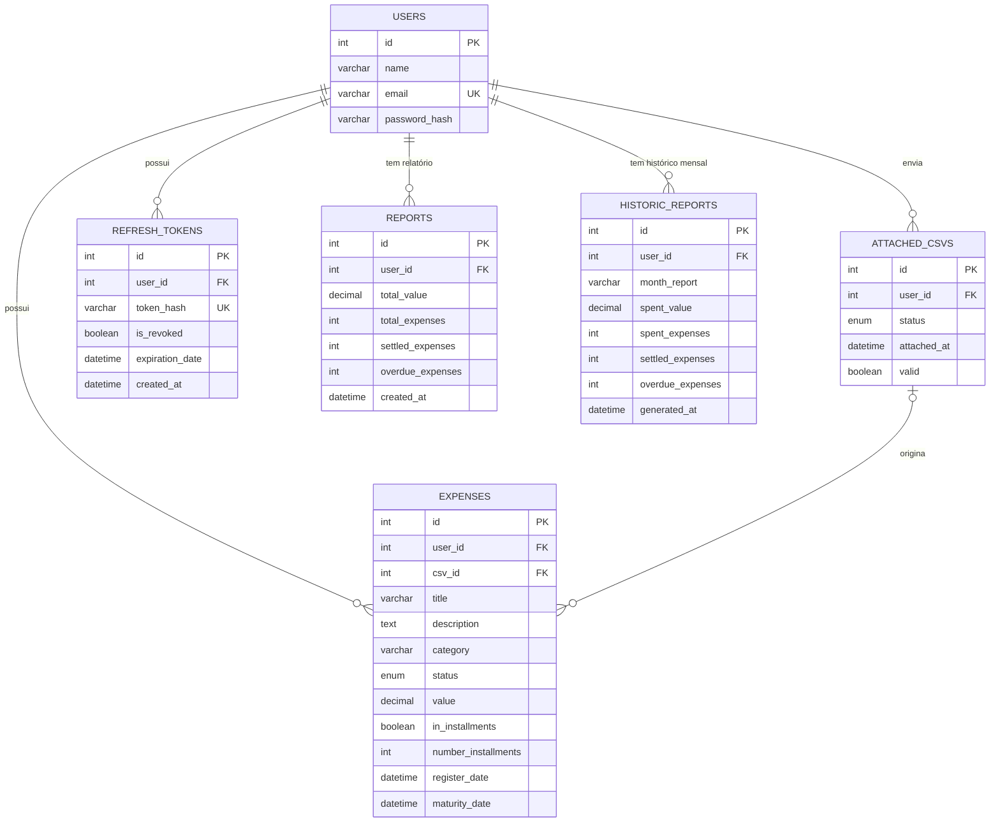

# Banco de dados

O banco é **MySQL** e todo o acesso é feito com **SQL puro**, sem ORM. As tabelas são criadas pelos arquivos `.sql` da pasta `migrations/`, executados automaticamente pelo MySQL na primeira subida do volume.

## Diagrama entidade-relacionamento

## Tabelas

| Tabela | Descrição |
|--------|-----------|
| `users` | Usuários da API. O `email` é único e a senha é guardada como hash `bcrypt` |
| `attached_csvs` | Cada CSV enviado, com o status do processamento e a flag `valid` |
| `expenses` | Despesas do usuário, cadastradas manualmente ou originadas de um CSV |
| `reports` | Totais consolidados de gastos e dívidas do usuário |
| `historic_reports` | Fechamento mensal dos totais, um registro por usuário e mês |
| `refresh_tokens` | Refresh tokens emitidos, com hash, validade e flag de revogação |

### Valores dos ENUMs

| Coluna | Valores |
|--------|---------|
| `attached_csvs.status` | `pendente`, `processando`, `sucesso`, `erro` |
| `expenses.status` | `pendente`, `pagando`, `quitado`, `atrasado` |

## Decisões de modelagem

- **Chaves estrangeiras com `ON DELETE RESTRICT`**: não é possível apagar um usuário ou CSV que ainda tenha registros dependentes.
- **`csv_id` é opcional**: despesas cadastradas manualmente não têm CSV de origem.
- **`attached_csvs.valid` nasce como `false`**: só vira `true` quando o CSV inteiro é processado com sucesso.
- **Sem tabela de categorias**: as categorias são fixas, definidas como enum no código e validadas no backend.
- **Sem vínculo direto entre `reports` e `expenses`**: os totais são calculados por agregação (`SUM` e `COUNT`) filtrando por `user_id`.
- **`historic_reports` guarda só totais consolidados**: o detalhamento das despesas de um mês é obtido filtrando `expenses` por `user_id` e intervalo de datas. Não é uma foto imutável: reflete os dados atuais daquele período.
- **Despesas parceladas ocupam uma única linha**: veja [Despesas](../usage/expenses.md).
- **Refresh tokens guardados com hash**: o token em texto puro nunca fica no banco.
