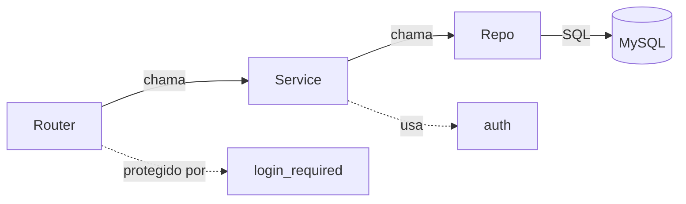

# Camadas da aplicação

O código da API fica em `app/` e é dividido em camadas, cada uma com uma responsabilidade.

```text
app/
├── app.py          # cria o Flask, configura o OpenAPI e registra os blueprints
├── celery.py       # instância do Celery e agendamento das tarefas periódicas
├── routers/        # rotas reais (blueprints) que recebem e respondem requisições
├── resources/      # blueprints do flask-smorest usados para documentar no Swagger
├── schemas/        # schemas usados na documentação das rotas
├── services/       # regras de negócio e validações
├── repo/           # acesso ao banco (queries em SQL puro)
├── auth/           # hash de senha, tokens JWT e decorator de proteção de rotas
└── uploads/        # arquivos CSV recebidos
tasks/              # tasks do Celery (fora do pacote app)
migrations/         # arquivos .sql executados na primeira subida do MySQL
tests/              # testes automatizados com pytest
```

## Fluxo de uma requisição



| Camada | Faz | Não faz |
|--------|-----|---------|
| **Router** | Lê a requisição, chama o service e devolve a resposta HTTP | Regra de negócio e SQL |
| **Service** | Valida dados, aplica regras e coordena o repositório | Falar SQL diretamente |
| **Repo** | Executa as queries e devolve os dados | Validação e regra de negócio |
| **Auth** | Valida e-mail e senha, gera e valida tokens, protege rotas | Acessar o banco |

## Convenções

- **Retorno dos services**: um dicionário com `success_message` no caminho de sucesso e `error_message` no caminho de erro (chaves separadas).
- **Erros ao cliente**: mensagens genéricas em português. Mensagens detalhadas dos `raise ValueError` ficam em inglês, apenas para depuração interna.
- **Datas**: recebidas como string ISO 8601 (`YYYY-MM-DD`) e convertidas para `datetime` no service.
- **Remoção**: `DELETE` retorna corpo vazio com status `204`.
- **Atualização**: `PUT` com o payload completo, passando pelas mesmas validações do `POST`.
- **Rotas com barra final**: as rotas raiz dos blueprints são chamadas sempre com `/` no final (ex.: `POST /auth/`).

## Proteção de rotas

O decorator `login_required` (em `app/auth/decorators.py`) valida o header `Authorization: Bearer <token>`, decodifica o JWT com PyJWT e libera a rota. Em qualquer falha, responde `401`. O claim `sub` do token é o `user_id` usado pelos services.

## Documentação das rotas

A rota real vive em `routers/`. Para aparecer no Swagger, um blueprint do `flask-smorest` em `resources/` apenas **documenta** a rota, sem executar a lógica: o service continua lendo `request.json`.
