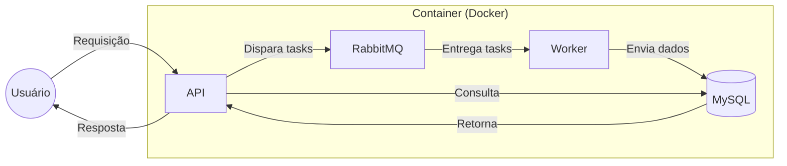

# Visão geral da arquitetura

Todo o ambiente roda em containers Docker: a API, o banco MySQL, o RabbitMQ e o worker do Celery.

## Componentes

| Componente | Responsabilidade |
|------------|------------------|
| **API (Flask)** | Recebe as requisições, valida o token, aplica as regras de negócio e responde |
| **MySQL** | Armazena usuários, despesas, CSVs, relatórios e refresh tokens |
| **RabbitMQ** | Recebe as tasks publicadas pela API e as entrega ao worker |
| **Worker (Celery)** | Processa os CSVs e executa as tarefas periódicas |

## Dois caminhos de requisição

**Caminho síncrono**: a maior parte das rotas (autenticação, CRUD de despesas, consulta de relatórios). A API consulta o MySQL e responde na hora.

**Caminho assíncrono**: o envio de CSV. A API apenas valida o arquivo, registra o job no banco e publica uma task no RabbitMQ, respondendo em seguida. O worker faz o trabalho pesado depois. Veja o fluxo completo em [Processamento de CSV](csv-processing.md).

## Decisões de arquitetura

- **Sem result backend**: o status do processamento fica na tabela `attached_csvs`, e o usuário acompanha consultando o próprio CSV (*polling*). Isso evita depender de Redis só para guardar estado.
- **Sem notificação ao fim do processamento**: não há e-mail nem outro canal; a consulta de status é o mecanismo oficial.
- **Dockerfile único**: API e worker usam a mesma imagem, cada um com seu `command`.
- **MkDocs fora do Compose**: a documentação é uma ferramenta de desenvolvimento, não parte do sistema em execução.
