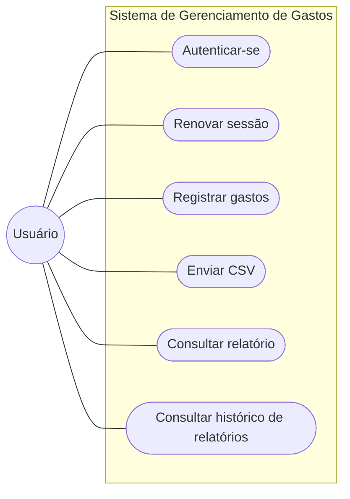

# Sistema de Gerenciamento de Gastos

API REST para gerenciamento de gastos mensais (aluguel, água, luz, parcelas etc.), construída com **Flask** e **SQL puro**. O usuário cadastra despesas manualmente ou envia um **CSV**, que é processado em segundo plano. A API calcula gastos totais e dívidas pendentes e mantém um histórico mensal de relatórios.

Esta é a documentação completa do projeto. Para rodar a aplicação rapidamente, consulte o `README.md` na raiz do repositório.

## O que o sistema faz

- Cadastro e autenticação de usuários, com senha protegida por `bcrypt`.
- Login por **Bearer Token** e renovação de sessão por **refresh token** com rotação.
- CRUD de despesas, incluindo despesas **parceladas**.
- Envio de **CSV** com processamento assíncrono (Celery + RabbitMQ): a API responde rápido e um worker grava as despesas.
- Status da despesa: `pendente`, `pagando`, `quitado` e `atrasado`.
- **Relatório** de gastos totais e dívidas pendentes, visível apenas para o próprio usuário.
- **Histórico mensal** de relatórios, fechado automaticamente por uma tarefa periódica.
- Documentação interativa da API com **Swagger/OpenAPI**.

## Casos de uso

## Tecnologias

| Camada | Tecnologia |
|--------|------------|
| API | Flask + flask-smorest (Swagger/OpenAPI) |
| Banco de dados | MySQL, com SQL puro (sem ORM) |
| Tarefas em segundo plano | Celery + RabbitMQ |
| Autenticação | PyJWT + bcrypt |
| Testes | pytest |
| Containerização | Docker e Docker Compose |
| Qualidade de código | isort, black, flake8 |
| Automação de comandos | taskipy |

## Requisitos do projeto

??? note "Requisitos funcionais"
    - Envio de CSV para processamento.
    - Cálculo automático de gastos totais e dívidas pendentes.
    - Relatório de gastos por usuário.
    - Preenchimento automático dos gastos a partir do CSV.
    - Status do gasto (`pendente`, `pagando`, `atrasado`, `quitado`) editável pelo usuário.
    - Cálculo adaptável para gastos parcelados.
    - API documentada.
    - Relatório visível apenas para o próprio usuário logado.
    - Renovação de login via refresh token.
    - Bloqueio e aviso em caso de CSV inválido.
    - Erro informado em caso de falha numa tarefa em segundo plano.

??? note "Requisitos não funcionais"
    - Cálculo de gastos e dívidas e processamento do CSV em segundo plano.
    - Documentação da API em Swagger/OpenAPI.
    - Login via Bearer Token.
    - Access token expira em 15 minutos e refresh token em 1 semana.
    - Refresh tokens armazenados com hash no banco.
    - Sistema coberto por testes automatizados.
    - Ambiente de desenvolvimento dependente de Docker.

## Como esta documentação está organizada

| Seção | O que você encontra |
|-------|---------------------|
| [Primeiros passos](getting-started/installation.md) | Instalar, subir o ambiente e fazer a primeira chamada |
| [Configuração do projeto](project-configuration.md) | Variáveis de ambiente, serviços do Docker Compose e Celery |
| [Arquitetura](architecture/overview.md) | Containers, camadas, banco de dados e fluxo do CSV |
| [Uso](usage/authentication.md) | Autenticação, despesas, CSV e relatórios na prática |
| [Referência](reference/endpoints.md) | Tabela de endpoints e mapa dos módulos |
| [Qualidade de código](code-quality.md) | Linters, testes e convenções |
