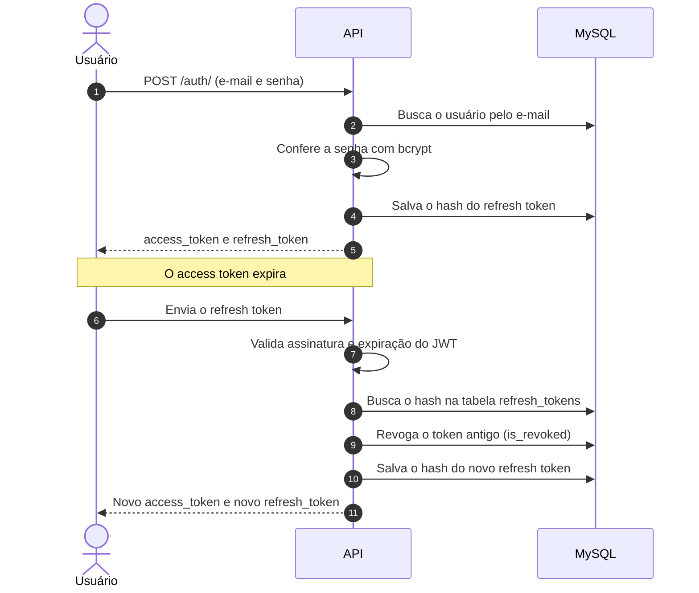

# Autenticação

A API usa **JWT** com dois tokens: um *access token* de curta duração, enviado em cada requisição, e um *refresh token* de longa duração, usado apenas para renovar a sessão.

## Cadastro de usuário

`POST /users/` cria o usuário. Antes de gravar, o service valida:

- **E-mail**: formato válido (biblioteca `email-validator`) e único no banco.
- **Senha**: no mínimo 8 caracteres, com pelo menos 1 letra maiúscula, 1 número e 1 caractere especial.

A senha é guardada como hash `bcrypt`, nunca em texto puro. A resposta não devolve dados do usuário, apenas uma mensagem de sucesso ou de erro.

## Login

`POST /auth/login/` recebe e-mail e senha e, se estiverem corretos, devolve:

| Campo | Descrição |
|-------|-----------|
| `access_token` | JWT de curta duração, usado nas rotas protegidas |
| `refresh_token` | JWT de longa duração, usado para renovar a sessão |
| `token_type` | Sempre `Bearer` |
| `success_message` | Mensagem de sucesso |

As rotas protegidas exigem o header:

```text
Authorization: Bearer <access_token>
```

## Renovação de sessão

Quando o access token expira, o cliente envia o refresh token e recebe um **novo par** de tokens. A renovação faz **rotação**: o refresh token antigo é revogado e o novo é salvo.



## Segurança

- Os refresh tokens ficam na tabela `refresh_tokens` **com hash**, permitindo revogar uma sessão antes da expiração natural.
- A validação de assinatura e de expiração é feita pelo próprio `jwt.decode`, sem checagem manual de datas.
- A proteção de rotas usa um decorator próprio (`login_required`) com PyJWT, sem `Flask-JWT-Extended`.
- Toda a configuração dos tokens vem do `.env`: a `SECRET_KEY` e o `ALGORITHM` definem a assinatura dos JWTs, e `ACCESS_TOKEN_EXPIRATION_TIME` e `REFRESH_TOKEN_EXPIRATION_TIME` definem a validade do access token e do refresh token.
