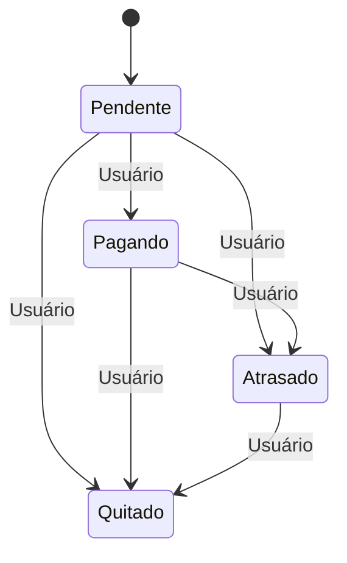

# Despesas

Todas as rotas de despesas exigem autenticação, e cada usuário só enxerga as próprias despesas.

## Operações

| Operação | Rota |
|----------|------|
| Criar | `POST /expenses/` |
| Listar | `GET /expenses/` |
| Detalhar | `GET /expenses/<id>` |
| Atualizar | `PUT /expenses/<id>` (payload completo) |
| Remover | `DELETE /expenses/<id>` (responde `204`) |

O `user_id` nunca vem no corpo da requisição: ele é extraído do claim `sub` do token.

## Campos de uma despesa

| Campo | Descrição |
|-------|-----------|
| `title` | Título da despesa |
| `description` | Descrição opcional |
| `category` | Categoria da despesa |
| `status` | `pendente`, `pagando`, `quitado` ou `atrasado` |
| `value` | Valor da despesa (ou da parcela, se for parcelada) |
| `in_installments` | Indica se a despesa é parcelada |
| `number_installments` | Número de parcelas (apenas se parcelada) |
| `register_date` | Data de registro, no formato `YYYY-MM-DD` |
| `maturity_date` | Data de vencimento, no formato `YYYY-MM-DD` |
| `csv_id` | CSV de origem, se a despesa veio de um arquivo |

Consulte o Swagger em `/docs/swagger` para o formato exato de cada payload.

## Despesas parceladas

- O **valor da parcela** é informado pelo usuário.
- O **valor total** é `valor da parcela × number_installments`.
- A despesa continua sendo **uma única linha** na tabela `expenses`: todas as parcelas vencem no mesmo dia de cada mês, e `number_installments` serve para calcular o total e quantas parcelas restam.
- As **parcelas pagas** não são gravadas: são calculadas a partir de `register_date`, contando os meses decorridos até hoje, limitados ao total de parcelas.

## Ciclo de vida do status

